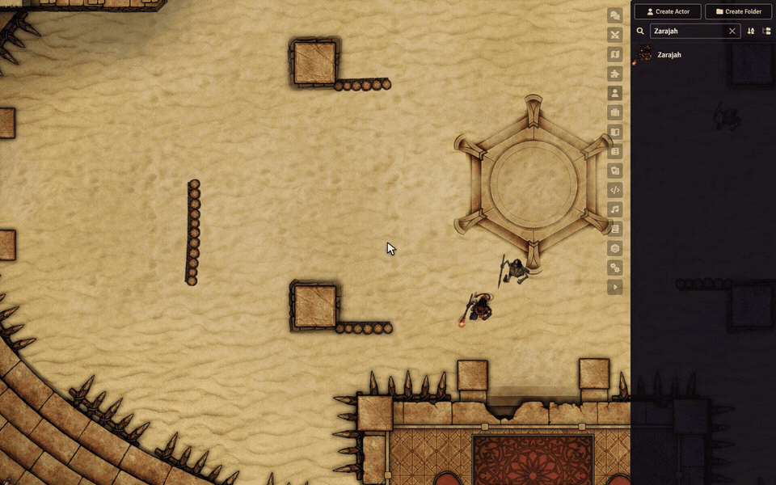

# Sephral’s Crucible Sheet & Quickbar

Sephral’s Crucible Sheet & Quickbar is a compact, play-focused hero and adversary sheet for the Crucible system in Foundry VTT, with a quickbar that stays open on the canvas during combat.

It is inspired by the principles of the Tidy5e sheet – dense lists, a play and an edit mode, search, inline details – but keeps Crucible's own look. Every user decides for themselves which characters open in it, so a single player can use it without affecting the other players or the GM.

## Discord

[](https://discord.gg/7BjCgDYaBP)

Questions, feedback, and module support are welcome on [Discord](https://discord.gg/7BjCgDYaBP).

## Demo



The demo uses Zarajah, one of Crucible's pregenerated heroes, and the arena of Crucible's playtest adventure. If the embedded preview is not available in your GitHub view, please check the media folder.

## Overview

- Compact hero and adversary sheet with resources, defenses and action economy always in view
- Quickbar: the sheet shrinks to a small, semi-transparent bar for the table
- Per-user choice: all characters, heroes only, single characters, or as set by the GM
- Searchable action lists with cost chips, target, "usable now" filter and one-click use
- One-click skill checks, pinned skills, sortable favorites
- Spellbook for composed spells (rune + gesture + inflection), cast with one click
- Combat helpers: your quickbar opens on your turn, a combat bar for the GM, cost preview, target checks
- Backgrounds (transparent, solid, Crucible, Ember codex), dark and light theme, compact mode
- Self-test that checks every sheet after Foundry, Crucible or Ember updates
- Supports Foundry VTT v14 with Crucible 0.11
- Includes English and German translations; every user can follow Foundry's language or pick one for this module

## Who sees the sheet

Enabling the module changes nothing for anyone. Each user chooses for themselves:

- **For all their characters:** *Configure Settings → Sephral’s Crucible Sheet & Quickbar → Use Sheet & Quickbar for* – all heroes and adversaries, heroes only, only characters chosen one by one, or as set by the GM (default).
- **For a single character:** right-click the actor in the actor directory → *Use Sheet & Quickbar (just for me)*, use the ⋮ menu of the Crucible sheet, or open Foundry's *Configure Sheet* dialog, which gets a section *just for you* at the top. The ⋮ menu of this sheet switches back to the standard sheet.
- **For everyone (GM):** *Default for everyone* sets the sheet for heroes, or heroes and adversaries, for all users who follow the GM. The default is *Nobody*.

The choice is stored as a user setting, never on the actor. That is why it is not offered among the sheet types of Foundry's *Configure Sheet* dialog, whose settings apply to all users; the dialog shows the personal choice in a section of its own instead. Open sheets switch immediately. The other features – turn notice, spellbook strip in Crucible's spell dialog, version notice for the GM – only act for characters the user sees in this sheet. Character creation (level 0) keeps using the system's creation sheet.

## Installation

Requirements: Foundry VTT 14 and the Crucible system 0.11 or newer. Ember is optional; with it the sheet shows the *Attunement* tab.

1. Install the module with its manifest URL `https://github.com/Sephral/sephrals-crucible-sheet-quickbar/releases/latest/download/module.json`, or unpack the release zip into `Data/modules/sephrals-crucible-sheet-quickbar/` (the folder name must match; `module.json` lies directly inside).
2. Enable the module in the world (*Manage Modules*, GM).
3. Choose the sheet for yourself: right-click your character in the actor directory → *Use Sheet & Quickbar (just for me)*.

## The sheet

- **Header (always visible):** portrait with level and milestone bar, health/wounds and morale/madness with thresholds, action/focus/heroism as clickable pips, active conditions, abilities, defenses (physical with its composition bar), movement, size, stride.
- **Play:** sidebar with equipment, skills (click = check), resistances, knowledge and languages; next to it all actions with cost chips, target, search and filters.
- **Inventory, Talents, Training, Spells, Effects, Attunement (Ember, heroes only), Biography.**

The adversary sheet uses the same layout, adapted to Crucible adversaries: taxonomy and archetype, threat rank, level with fractional steps, a star for *important* adversaries (only those show wounds and madness), heroism only when present, no rest buttons.

## Quality-of-life features

| Feature | How |
| --- | --- |
| Use an action or item | Click its icon |
| Roll without the dialog | Shift+click (or the *Quick mode* setting, which reverses it); targets are still checked like in the dialog (range, count, flanking …) |
| Read a description | Click the name to expand the details inline |
| Open an item sheet | Double-click a row |
| Context menu | Right-click (use, use immediately, favorite, equip, edit, delete) |
| Search | Search field per tab, Escape clears it |
| Usable now | Hides actions whose cost cannot be paid right now |
| Relative values | Type "-7" or "+5" into a resource field |
| Play / edit mode | Lock in the header; play mode hides delete and edit controls |
| Recover / rest | Buttons in the header (heroes) |
| Your turn | Glowing portrait, initiative badge and an *End turn* button in the header and the quickbar. Only the GM can end the last turn of a round (a Crucible rule); the button shows that |
| Next turn | When your hero acts next in the round, the initiative badge and the quickbar get a quiet frame and a short notice appears |
| Delay | After Crucible's *Delay* action an hourglass next to the initiative shows the new and the original initiative |
| Cost preview | Hovering an action pulses the action, focus and heroism pips it costs; missing pips turn red |
| Conditions | In the header and the quickbar with their remaining rounds; maintained effects have a gold frame and an ✕ to end them |
| Repeat last spell | Button in the Spells tab and the quickbar |
| Sort favorites | Drag and drop favorites (and quickbar buttons) |
| Pin skills | Pin icon next to a skill: it then appears among the favorites and in the quickbar |
| Charges | −/+ next to charges in the inventory |
| Keyboard | Every clickable element is reachable with Tab; Enter or Space triggers it |
| Keybindings | Switch between sheet and quickbar, end your turn, use quickbar buttons 1 to 9. They have no default keys, because core already uses the digits and Q/E. Assign them under *Configure Controls* |
| Penalties | Negative values red, bonuses green |
| Settings | Gear button in the sheet header (quickbar: in its title bar) opens the module's page in Foundry's settings |

The module brings German skill and training names (Athletik, Wahrnehmung, Arkanes …).

## Quickbar

**Double-click the title bar** of the sheet (or use the button in the header) to turn the sheet into a small, semi-transparent bar that can stay open during play. Double-click again (or use the arrow button in the bar) to restore the full sheet in its old place. It works for adversaries too.

- Portrait with level and initiative, health and morale as bars with direct input ("-7", "+5"), action/focus/heroism pips, defenses, active conditions, *End turn*.
- Action bar: favorites, spellbook entries and pinned skills in favorite order, with cost or bonus badges. Click = use, Shift = immediately, right-click = menu, hover = Crucible's card. Outside your own turn Crucible adds reactions automatically.
- The dice button expands all skills for direct checks.
- Transparent while the mouse is elsewhere (*Quickbar opacity* setting); fully visible on hover and on your turn (then the frame glows).
- Escape does not close the bar. Mode, position and *open* are remembered per actor in the browser; an open bar reopens after a reload.
- **Targets:** with tokens targeted, a row shows name, physical defense, the three saves, distance and the target's conditions as small icons (the GM also sees health, and the frame color shows hostile or friendly). Click to pan to the token. Buttons that cannot reach this target (too close, too far, not flanked …) are marked red. The ⛔ icon names the reason.

## In combat

- **Players:** when your hero's turn begins, its quickbar opens (if the sheet is closed), glows and announces the turn. An open full sheet stays a full sheet. One turn earlier a short notice says that you are next.
- **GM combat bar:** when an adversary's turn begins, its quickbar opens in a fixed place and its token is selected; the bar follows the next adversary and closes on hero turns. Moving it sets the place. Double-click turns it into an ordinary sheet that stays open.
- Adversaries without favorites get their attacks, abilities and *Defend* in the quickbar automatically.
- If a healing effect (e.g. a healing potion) targets an adversary, the module asks first.

## Spellbook

Composed spells (rune + gesture + optional inflection, and the damage type where it can be chosen) can be saved as presets and cast again with one click. They are stored on the actor, so they work on every client.

| Where | What |
| --- | --- |
| Spells tab → *Create spell* | Builder with live preview (name, cost, target) and an optional custom name; saves without casting |
| Crucible's spell dialog | *Spellbook* strip: a chip loads a preset, *☆ Save* stores the current combination (for characters the user sees in this sheet) |
| Play tab favorites, Spells tab | Click the icon: the dialog opens pre-filled; Shift+click casts immediately; the star removes it |
| Rename | Right-click → *Rename*, or the pencil in edit mode; empty = spell name |

If the hero no longer knows a component (e.g. after a talent respec), the entry stays visible, greyed out, and names the missing component. Spells and actions placed on the map (aura, cone, summon …) always open the dialog, because the region is placed there. As usual in Crucible, damage, healing and costs apply once the GM confirms the chat card.

## Settings

All options are in Foundry's settings dialog (*Configure Settings*) on the page of this module. The gear button in the sheet header, or in the title bar of the quickbar, opens that page directly. They appear in this order:

| Topic | Options |
| --- | --- |
| Language | *Follow Foundry* (default), *Deutsch* or *English*, for this module only |
| Sheet | Use Sheet & Quickbar for (as set by the GM / all / heroes only / one by one); for the GM the default for everyone |
| Display | Color scheme, background and its opacity, compact mode, quickbar opacity, double-click on the title bar, remaining rounds on conditions |
| Controls | Quick mode, cost preview, repeat last spell, spellbook in the spell dialog, confirmation before healing adversaries |
| Targets | Target in the quickbar, mark unsuitable actions |
| Combat | Quickbar on your turn, announce your turn, combat bar (GM), fill adversary quickbars (GM) |
| Self-test (GM) | Button *Run self-test* at the top of the page |

The language is stored per browser, like in every Sephral module. *Follow Foundry* uses Foundry's language, including community translations; a fixed choice switches the module's own texts only, Crucible keeps Foundry's language. Personal options apply per user on every device; world options apply to everyone.

- **Background:** *Transparent* (default, opacity 0.3: the map shows through, blurred), *Solid*, *Crucible* (texture and arena motif of the standard Crucible sheet), *Ember codex* (only with the Ember module). Every variant exists in the dark and the light theme; the quickbar keeps its own background.
- **Compact mode** (default: on) makes type, icons and spacing smaller in the sheet and the quickbar. New sheets open a little smaller; open windows switch immediately.

## Stored data

| Actor flag | Content |
| --- | --- |
| `sephrals-crucible-sheet-quickbar.spellFavorites` | Spellbook entries `{id, damageType?, label?}` |
| `sephrals-crucible-sheet-quickbar.favoriteOrder` | Favorite order (`a:<action>`, `s:<spell>:<damage>`, `k:<skill>`) |
| `sephrals-crucible-sheet-quickbar.pinnedSkills` | Pinned skills |

Everything else (last tab, lock state, quickbar position) stays in the browser (`localStorage` key `sephrals-crucible-sheet-quickbar.ui`). The sheet choice is a user setting.

### Migration from Crucible Folio

The module was previously called *Crucible Folio* (id `crucible-folio`). On the first start it copies that module's data once: every user's own settings and browser state, and – for the GM – the world setting and the flags of world actors and unlinked tokens. Nothing is deleted, so the old data remains for a rollback. While *Crucible Folio* is still enabled in the same world, this module stays idle and asks the GM to disable the old one.

## Self-test after updates

The sheet uses some Crucible and Ember internals. After an update of Foundry, Crucible or Ember the module tells the GM once that newer versions are running. Then run *Configure Settings → Sephral’s Crucible Sheet & Quickbar → Run self-test* (or `game.modules.get("sephrals-crucible-sheet-quickbar").api.runSelfTest()`): it opens every hero sheet invisibly (full and as quickbar), the button also a random sample of 20 adversaries and the API call every adversary, checks the integrations and whispers a report to the GM. The test changes no data and no stored window state.

## Limitations

- Crucible only. In worlds of other systems the module does nothing.
- Crucible is not yet at 1.0 and changes internals between minor versions. The module builds on the Crucible hero and adversary sheet classes, `SpellCastDialog`, `CrucibleSpellAction` and the `SYSTEM` constants, and wraps Foundry's `Actor#_getSheetClass` for the personal sheet choice. Verified with Crucible 0.11.1, Ember 0.6.3 and Foundry 14.369; run the self-test after updates.
- Character creation (level 0) keeps using the system's creation sheet.
- The *Attunement* tab and the *Ember codex* background need the Ember module.

## Development

| File | Content |
| --- | --- |
| `scripts/scsq.mjs` | Entry point: registration, hooks, API |
| `scripts/settings.mjs` | All settings, the self-test button and the link to Foundry's settings dialog |
| `scripts/language.mjs` | Module language: follow Foundry or a fixed German or English interface |
| `scripts/sheet-choice.mjs` | Who sees which actor in this sheet: user setting, single choices, menu entries |
| `scripts/migration.mjs` | One-time migration from the earlier id `crucible-folio` |
| `scripts/config.mjs` | Constants, tested versions, browser UI state |
| `scripts/prepare.mjs` | Data preparation for the templates |
| `scripts/folio-sheet.mjs` | `FolioSheetMixin` (sheet logic, quickbar, drag and drop) and the hero and adversary classes |
| `scripts/spell-favorites.mjs` | Spellbook, spell dialog strip, builder |
| `scripts/combat.mjs` | Combat helpers: quickbar on your turn, notice when you are next, GM combat bar, refresh on target changes |
| `scripts/keybindings.mjs` | Keybindings: switch sheet and quickbar, end turn, quickbar buttons 1 to 9 |
| `scripts/selftest.mjs` | Self-test |
| `tests/` | Node tests (`node --test`): pure helpers, language files, release script |

Internally the code still uses the earlier name *Folio* for classes, CSS classes (`.folio`, `fo-*`) and localization keys (`FOLIO.*`).

Validation and release:

```text
npm run check
npm run check:manifest
npm test
npm run release:prepare
```

Reload templates and CSS without reloading the client:

```js
game.modules.get("sephrals-crucible-sheet-quickbar").api.devReload()
```

Changes to JavaScript or the language files need a client reload. Foundry 14 imports module CSS into the `modules` cascade layer. Ember places its rules in the `modules.ember` and `exceptions.ember` layers; overriding the `exceptions` rules needs `!important`.

## License

See [LICENSE.md](LICENSE.md).
